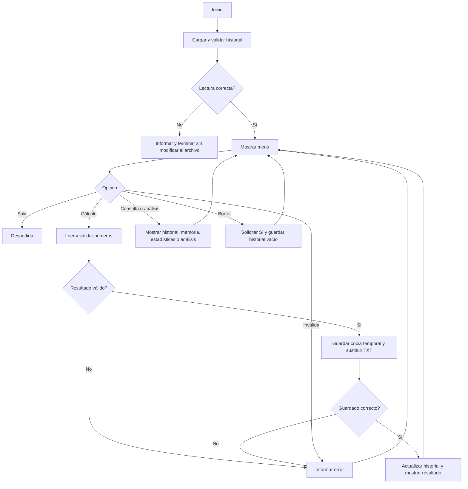
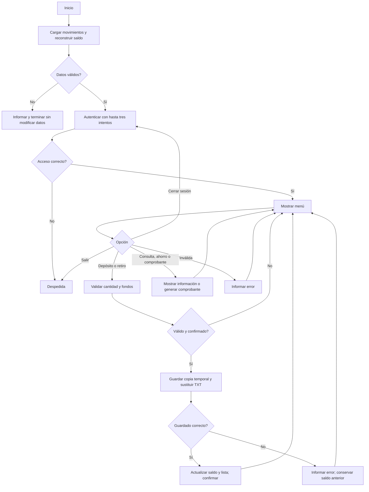

# Proyecto final de Programación Estructurada en Python

## Descripción general

Este repositorio contiene dos programas independientes de consola para un proyecto académico de primer semestre: una calculadora multifuncional y un simulador de cajero automático llamado **Python Bank**. Están escritos en español, organizados mediante funciones y utilizan únicamente la biblioteca estándar de Python.

## Problema que resuelve cada programa

- **Calculadora:** facilita operaciones matemáticas cotidianas, comparaciones y análisis de listas. Su historial permite recuperar cálculos anteriores, consultar estadísticas y reutilizar el último resultado.
- **Python Bank:** permite practicar la administración de una cuenta ficticia mediante depósitos, retiros, consultas y comprobantes. Conserva los movimientos para reconstruir el saldo y ofrece una proyección de ahorro sin intereses.

## Objetivos

- Aplicar variables, operadores, condicionales, ciclos y estructuras de datos en aplicaciones interactivas.
- Separar responsabilidades mediante funciones con parámetros y valores de retorno.
- Validar entradas y manejar errores comunes sin terminar inesperadamente el programa.
- Conservar información en archivos de texto y presentar resultados claros.
- Facilitar la explicación del código y su modificación después de recibir retroalimentación.

## Características

### Calculadora

- Suma, resta, multiplicación, división, división entera, módulo, potencia, raíz cuadrada y porcentaje.
- Tabla de multiplicar del 1 al 10 y comparación de dos números.
- Análisis de listas: suma, promedio, máximo, mínimo, valores superiores al promedio y valores únicos.
- Historial completo o de las últimas cinco operaciones aritméticas, con fecha y hora.
- Estadísticas recuperadas del historial, operaciones pendientes de usar y empates de las más utilizadas.
- Memoria del último resultado persistente: escribe `M` cuando se solicite un número para reutilizarla.
- Borrado del historial con confirmación `SI`; también reinicia memoria y estadísticas.
- Rechazo de entradas no numéricas, `nan`, infinitos y resultados fuera del dominio real finito.

Las tablas, comparaciones y análisis de listas no se guardan en el historial aritmético ni sustituyen la memoria. En porcentaje se pide primero la cantidad base y luego el porcentaje: `200` y `15` producen `30`. La división entera redondea hacia abajo: `-9 // 2` produce `-5`. Se utiliza el comportamiento de Python para `0 ** 0`: devuelve `1`.

### Python Bank

- Autenticación ficticia con un máximo de tres intentos por proceso de acceso.
- Consulta del saldo y de los datos públicos de la cuenta.
- Depósitos y retiros de pesos enteros positivos, confirmados escribiendo `SI`.
- Consulta de todos los movimientos, últimos cinco, depósitos o retiros.
- Resumen con totales, conteos, máximos y promedios.
- Proyección mensual de ahorro sin modificar el saldo.
- Comprobante TXT del último movimiento, incluso después de reiniciar el programa.
- Cierre de sesión y regreso al acceso; tres fallos de acceso finalizan el programa.
- Recuperación del saldo y validación de su continuidad a partir de los movimientos.

Cualquier respuesta distinta de `SI` cancela una confirmación. No es necesario incluir la tilde: se escribe `SI`, en mayúsculas o minúsculas.

## Requisitos

- Python 3; se recomienda Python 3.10 o posterior. Las pruebas se ejecutaron con Python 3.14.7.
- Una terminal. Visual Studio Code es opcional.
- Permiso de escritura en las carpetas de los programas.
- No se requieren dependencias externas, instalaciones con `pip`, conexión a internet ni servicios financieros.

## Instrucciones de ejecución

Abre la carpeta raíz del proyecto en Visual Studio Code y selecciona **Terminal → Nueva terminal**. Ejecuta uno de estos comandos:

```powershell
python Calculadora/calculadora.py
```

```powershell
python Cajero/cajero.py
```

En Windows, si `python` no está disponible pero instalaste el lanzador de Python, usa `py -3` en su lugar. En sistemas donde el ejecutable se llama `python3`, usa ese nombre.

Credenciales **ficticias y públicas** para probar Python Bank:

| Dato | Valor |
| --- | --- |
| Usuario | `cliente01` |
| NIP | `1234` |
| Titular | Juan Pérez |
| Cuenta | `00012345` |
| Tipo / moneda / estado | Ahorros / MXN / Activa |
| Saldo de primera ejecución | $1,000 MXN |

El NIP se introduce con `input()` y es visible al escribirlo. No constituye un mecanismo de seguridad real. La consulta de datos y el comprobante no imprimen el NIP.

Usa punto como separador decimal en la calculadora. En el banco, introduce enteros sin separadores de miles ni decimales. La opción `0` cierra cada programa desde su menú; `Ctrl+C` o el fin de la entrada también terminan la sesión de manera controlada.

## Estructura del proyecto

```text
Proyecto final programacion estructurada/
├── Calculadora/
│   ├── calculadora.py
│   └── historial_calculadora.txt    # Se genera al guardar o borrar
├── Cajero/
│   ├── cajero.py
│   ├── movimientos.txt             # Se genera con el primer movimiento
│   └── comprobante.txt             # Se genera cuando se solicita
├── README.md
├── GUIA_EXPOSICION.md
├── ARQUITECTURA.md
├── pruebas.py
├── .gitignore
└── .gitattributes
```

Cada archivo Python principal contiene la aplicación completa. `pruebas.py` verifica funciones y recorridos de consola usando copias y datos temporales. `GUIA_EXPOSICION.md` es material de estudio. `ARQUITECTURA.md` explica las decisiones de organización.

Los TXT se guardan junto al programa correspondiente, aunque este se ejecute desde otro directorio. No se distribuyen historiales ni movimientos de prueba: una copia limpia inicia sin esos archivos.

## Conceptos de programación aplicados

| Tema | Calculadora | Python Bank |
| --- | --- | --- |
| Variables y tipos | Entradas `str`, opciones `int`, operandos `float` y condiciones `bool` | Credenciales `str`, dinero `int`, promedios `float` y `sesion_activa` de tipo `bool` |
| Operadores | `+`, `-`, `*`, `/`, `//`, `%`, `**`, comparaciones y operadores lógicos | Suma y resta del saldo, acumuladores `+=`, comparaciones, `and`, `or`, `not` |
| Condicionales | Selección de operaciones y validación del dominio | Credenciales, fondos, confirmaciones y menú |
| Ciclos `for` | Tabla con `range()`, captura de listas y recorrido del historial | Intentos de acceso con `range()`, resumen y proyección mensual |
| Ciclos `while` | Menú y reintentos de entrada; `break` al salir y `continue` ante memoria vacía | Menú, nueva autenticación y validación de cantidades; `break` al salir |
| Listas | Historial, números con `append()`, últimas cinco con slicing y comprensión de superiores al promedio | Movimientos, listas de cantidades, slicing y filtros mediante comprensión |
| Tuplas | Catálogo de operaciones y registros `(fecha_hora, tipo, expresión, resultado)` | Registros `(tipo, cantidad, fecha, hora, saldo)` y pares de la proyección |
| Sets | Valores únicos, tipos utilizados y diferencia con operaciones disponibles | Tipos presentes en los movimientos consultados |
| Diccionarios | Estadísticas, resultados del análisis, recorridos con `items()` y `values()` | Cuenta, resumen, datos públicos y recorrido con `items()` |
| Funciones | Operaciones que retornan valores y funciones separadas para imprimir | Registro, lectura, filtros, resumen, presentación y autenticación |
| Archivos | Lectura TXT con `with open(..., 'r')`, iteración de líneas y escritura con `w` | Lectura de movimientos, escritura de una copia temporal y comprobante con `w` |
| Excepciones | `ValueError`, `OverflowError`, `FileNotFoundError`, errores de escritura e interrupción de entrada | Errores numéricos, de archivos, datos incoherentes e interrupción de entrada |
| Mutabilidad y alcance | La lista del historial cambia con `append()`; cada tupla permanece fija; los operandos son locales | El diccionario de la cuenta cambia después de guardar; el saldo proyectado es una variable local |

No se incorporaron métodos o estructuras sin utilidad concreta: por ejemplo, no se necesitan `pop()`, recursividad, clases ni bases de datos.

## Diagramas de flujo

### Calculadora



### Python Bank



## Persistencia de información

Los TXT usan UTF-8 y una línea por registro, con campos separados por `|`.

Calculadora:

```text
2026-11-23 12:00:00|Suma|2.0 + 3.0|5.0
```

Banco:

```text
Depósito|500|2026-11-23|12:00:00|1500
Retiro|200|2026-11-23|12:05:00|1300
```

Estos son ejemplos del formato, no archivos de datos incluidos. No edites manualmente los TXT durante la ejecución.

- **Modo `r`:** lee un archivo existente. Si no existe, `FileNotFoundError` permite iniciar con historial vacío o con $1,000 en el banco.
- **Modo `w`:** crea o reemplaza el contenido de un archivo. Se usa para preparar el historial completo en un archivo temporal y para reemplazar el comprobante anterior.
- **Modo `a`:** agrega contenido al final sin borrar lo anterior. Sería útil para un registro sencillo, pero aquí no se utiliza: ambos historiales se preparan completos en un temporal para evitar dejar una línea incompleta en el archivo principal si falla la escritura.

La secuencia de guardado es: construir la nueva lista, escribir y cerrar el temporal `.tmp`, sustituir el TXT con `Path.replace()` y, finalmente, modificar los datos en memoria. Si falla la escritura o la sustitución, no se confirma la transacción y se conservan los datos anteriores en memoria y en el archivo principal. `finally` intenta retirar el temporal. Esta es una protección sencilla para uso local, sin concurrencia.

`movimientos.txt` es la única fuente persistente del saldo. Se empieza con $1,000 y se comprueba cada depósito o retiro contra su saldo resultante. Un registro inválido detiene el acceso y muestra la línea problemática: no reinicia silenciosamente la cuenta. La calculadora también detiene la apertura si su historial tiene formato inválido. Conviene conservar una copia antes de corregir manualmente un archivo dañado.

La memoria y las estadísticas se obtienen del historial de la calculadora; no necesitan archivos adicionales. El comprobante es una salida de consulta, no una fuente del saldo.

## Pruebas realizadas

Ejecuta desde la raíz:

```powershell
python pruebas.py
```

Se ejecutaron **seis grupos de pruebas**, todos aprobados, con Python 3.14.7 en Windows. El script utiliza `assert`, datos temporales, simulaciones de errores con `unittest.mock` y ocho ejecuciones de los programas como procesos independientes. No modifica los TXT de uso normal.

| Grupo | Escenarios comprobados | Resultado |
| --- | --- | --- |
| Cálculos | Las nueve operaciones, división entera negativa, tres operaciones entre cero, raíz negativa, potencias inválidas y desbordamiento, valores no finitos, tabla, comparación y análisis de listas | Aprobado |
| Entradas | Texto no numérico, memoria vacía y reutilización, `nan`, infinitos, cero, negativos y decimales en campos enteros | Aprobado |
| Historial de calculadora | Primera ejecución, siete registros, últimas cinco, recuperación, memoria, conteos, fallo de sustitución, cancelación y confirmación del borrado, archivos inválidos | Aprobado |
| Funciones bancarias | Saldo inicial, depósito, retiro, retiro de todo el saldo, fondos insuficientes, cantidades inválidas, cancelaciones, filtros, últimas cinco, resumen, ahorro, comprobante y datos corruptos | Aprobado |
| Consola de calculadora | Menú completo de operaciones, errores comunes, tabla, comparación, lista, consultas, memoria, reinicio, borrado y detención ante archivo inválido | Aprobado |
| Consola bancaria | Tres fallos de acceso, acceso después de un fallo, historial vacío, depósitos y retiros, consultas, filtros, resumen, ahorro, comprobante, cierre de sesión, reinicio y archivo inválido | Aprobado |

También se simularon errores al abrir el archivo para escritura y al sustituirlo: el saldo, los movimientos y el TXT original del banco permanecieron iguales. Las consolas se ejecutaron desde un directorio distinto al de sus scripts y guardaron los datos junto a sus respectivas copias. El banco conservó $1,300 después de depositar $500, retirar $200 y reiniciar. El ahorro proyectó $1,500 después de dos meses de $100, sin cambiar esos $1,300 reales de la simulación.

## Limitaciones

- Son aplicaciones académicas de consola, para una sola persona y un proceso a la vez. No abras dos instancias del mismo programa sobre los mismos TXT: no existe control de concurrencia.
- Python Bank tiene una sola cuenta ficticia, credenciales visibles y datos sin cifrar. No se conecta a dinero real, no cambia NIP ni administra usuarios.
- El banco solo acepta pesos enteros; los promedios se muestran con dos decimales.
- La calculadora usa `float`: existen aproximaciones binarias, por ejemplo en operaciones con `0.1`. No ofrece precisión decimal arbitraria ni números complejos. Cantidades extremadamente pequeñas pueden redondearse a cero.
- Los historiales se cargan en memoria y se reescriben completos en cada modificación, una decisión adecuada para volúmenes pequeños de clase.
- La sustitución temporal no equivale a respaldos ni garantiza recuperación frente a apagones, daños físicos o modificaciones externas. Un TXT bancario eliminado no puede distinguirse de una primera ejecución.
- No hay límites artificiales para el tamaño de las listas o la cantidad de meses; entradas excesivas pueden tardar o consumir mucha memoria. Utiliza cantidades razonables para la demostración.
- La fecha y hora provienen del reloj local del equipo. Mermaid requiere un visor compatible para mostrar los diagramas como gráficos.

## Preparación para GitHub

`.gitignore` excluye cachés de Python, archivos temporales, el entorno virtual y los TXT generados. `.gitattributes` mantiene finales de línea consistentes en los fuentes y documentos.

El repositorio local utiliza la rama `main` y la identidad de GitHub `hasanixz` con su correo `noreply`, configurada únicamente para este proyecto. La versión inicial está guardada en un commit local. Todavía no hay un repositorio remoto conectado.

Para guardar cambios posteriores, revisa primero qué vas a incluir:

```powershell
git status
git add .gitattributes .gitignore README.md GUIA_EXPOSICION.md ARQUITECTURA.md pruebas.py Calculadora/calculadora.py Cajero/cajero.py
git diff --cached
git commit -m "Describir los cambios realizados"
```

Después crea un repositorio vacío en GitHub. Estos comandos son una guía para ejecutarlos tú; **no se ha publicado el proyecto**:

```powershell
git branch --show-current
git remote add origin https://github.com/TU_USUARIO/TU_REPOSITORIO.git
git push -u origin NOMBRE_DE_TU_RAMA
```

Sustituye los marcadores por tus datos y la rama mostrada. Si ya existe un remoto llamado `origin`, revisa `git remote -v` antes de agregar otro.

## Conclusión y aprendizaje

El proyecto permite practicar cómo combinar funciones, ciclos, estructuras de datos, validaciones y archivos para resolver tareas concretas.

**Espacio para personalizar después de estudiar y ejecutar el código:**

- El concepto que ahora puedo explicar mejor es: __________.
- Una dificultad que encontré y cómo la resolví: __________.
- Una mejora sugerida durante la retroalimentación: __________.
- El cambio que realizaría y cómo lo comprobaría: __________.
